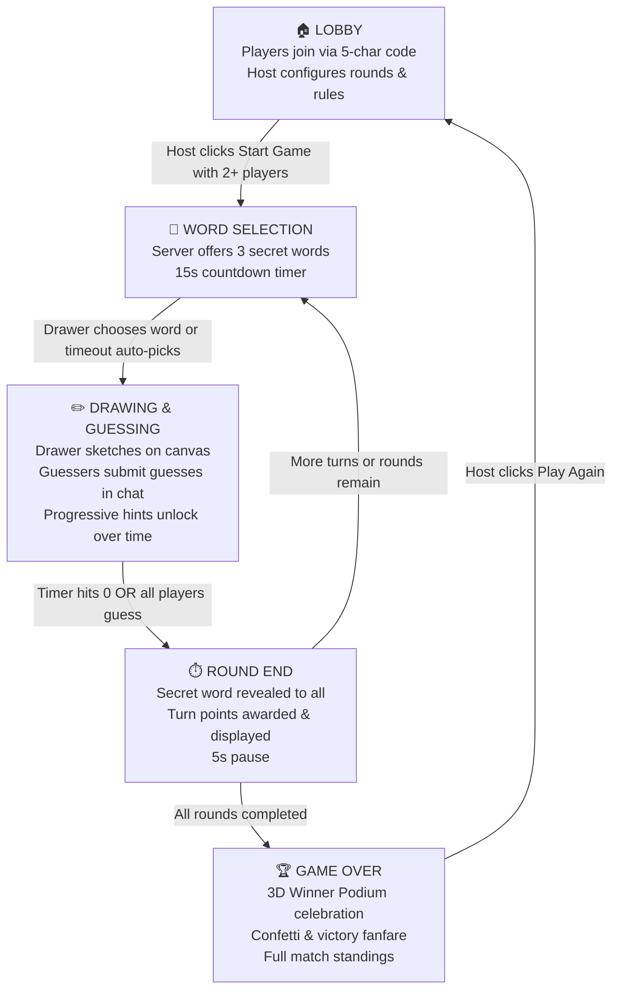
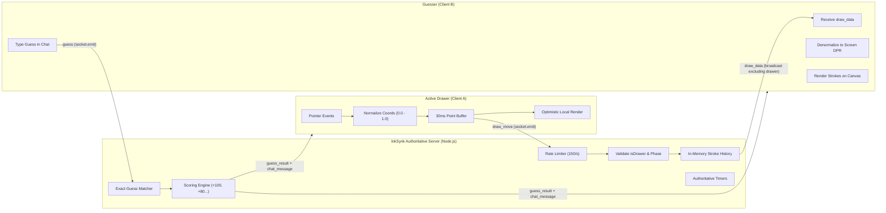
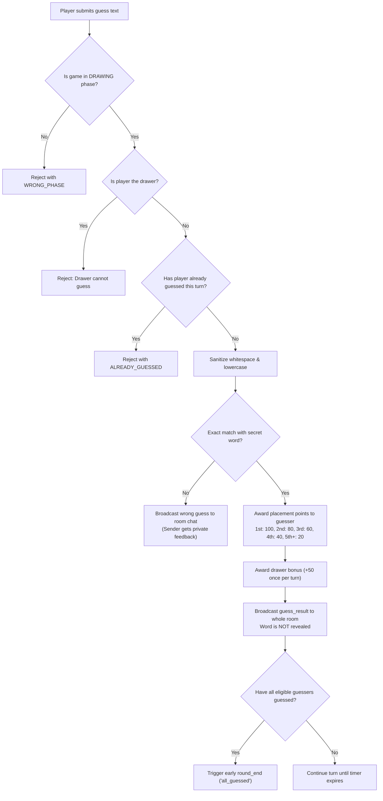

# InkSynk — Real-Time Multiplayer Drawing & Guessing Game

> **Backend Service:** `https://inksynk-v9lk.onrender.com`  
> **Live Deployment:** `https://<YOUR-RENDER-FRONTEND-URL-HERE>` *(Replace with your deployed frontend URL after deployment)*

---

InkSynk is a modern, high-energy real-time multiplayer drawing and guessing game inspired by skribbl.io. Built with React 18, Vite, Node.js, Express, and Socket.IO, InkSynk features an authoritative server engine, sub-30ms canvas synchronisation, procedural sound effects, and a responsive party-game UI.

---

## 📊 Visual System Diagrams & Flowcharts

### 1. Game Lifecycle & State Machine



---

### 2. Real-Time Network & Data Architecture



---

### 3. Guessing & Scoring Pipeline



---

## 🚀 Key Features

* **Authoritative Server Architecture:** All game state, room lifecycle, timers, turns, and scores are managed exclusively on the server. Clients cannot alter game state or manipulate scores.
* **Real-time Synchronized Canvas:** HTML5 canvas with normalized floating-point coordinates ($0.0$ to $1.0$) and DPR scaling. Drawings appear identical across all screen sizes and resolutions.
* **Smooth Point Batching:** Drawing coordinates are buffered and streamed every 30ms (up to 100 points/batch), ensuring fluid strokes without network saturation.
* **Strict Word Secrecy & Dynamic Hints:** Words are never broadcast to guessers until a round ends. Guessers see progressive letter reveals (e.g. `_ _ a _ _`) that unlock as the countdown timer runs.
* **Tiered Speed Scoring:** Faster guessers earn higher points ($100 \rightarrow 80 \rightarrow 60 \rightarrow 40 \rightarrow 20$). The drawer earns $+50$ bonus points if at least one player guesses their sketch.
* **Dual-Mode Chat & Guessing:** Non-solvers type guesses (wrong guesses broadcast publicly). Solvers and the drawer unlock a private secret chat channel.
* **Interactive UI/UX:** Warm-up doodle pad on Home, custom avatar selector, floating emoji reactions, dynamic urgency countdown timer, and 3D celebratory winner podium.
* **Zero-Dependency Web Audio & Confetti:** Procedural synthesized audio effects (chimes, clicks, timer ticks, fanfare) and canvas particle explosions.
* **Hardened & Rate-Limited:** Sliding-window rate limiters, 64 KB message buffers, payload type validation, and automatic host migration upon disconnect.

---

## 🛠️ Technology Stack

| Layer | Technologies |
| :--- | :--- |
| **Frontend** | React 18, Vite, Socket.IO Client, Native Canvas 2D API, Web Audio API, CSS Variables & Grid |
| **Backend** | Node.js (>= 18), Express, Socket.IO, CORS |
| **State Storage** | In-memory room store (zero external database dependencies for low latency) |
| **Testing** | Node.js test runner, custom Socket.IO integration suites (440+ automated checks) |
| **Deployment Target** | Render (Web Service for backend, Static Site for frontend) or Vercel |

---

## 📁 Project Structure

```text
skribbl-clone/
├── client/
│   ├── src/
│   │   ├── components/
│   │   │   ├── ChatPanel.jsx         # Guess & chat history + quick reaction bar
│   │   │   ├── DrawingCanvas.jsx     # HTML5 Canvas with normalized rendering
│   │   │   ├── DrawingToolbar.jsx    # Palette swatches, brush sizing, eraser, undo, clear
│   │   │   ├── GameOver.jsx          # 3D winner podium, tie resolution, play again
│   │   │   ├── Header.jsx            # Brand mark, room code pill, sound toggle, status
│   │   │   ├── Leaderboard.jsx       # Live match standings with rank badges & delta chips
│   │   │   ├── PlayerList.jsx        # Dynamic avatar gradients, drawing pencil, score tags
│   │   │   ├── SettingsForm.jsx      # Room configuration editor
│   │   │   ├── SettingsSummary.jsx   # Read-only rule summary chips
│   │   │   ├── Timer.jsx             # Server-synced countdown with urgency audio ticks
│   │   │   ├── WordChoices.jsx       # Drawer secret word selection modal
│   │   │   └── WordHint.jsx          # 3D tile hints with flip animation
│   │   ├── hooks/
│   │   │   ├── useChat.js            # Chat message stream
│   │   │   ├── useGameSession.js     # Drawer word choices & secret word
│   │   │   └── useSocket.js          # Socket.IO connection & request-ack handler
│   │   ├── lib/
│   │   │   ├── audio.js              # Pure Web Audio synthesizer
│   │   │   ├── confetti.js           # Canvas particle burst engine
│   │   │   └── drawingRenderer.js    # Coordinate normalization & segment renderer
│   │   ├── pages/
│   │   │   ├── Home.jsx              # Avatar picker, warm-up pad, create/join room
│   │   │   ├── Lobby.jsx             # Room code hero, player grid, share options, host controls
│   │   │   └── Game.jsx              # 3-column game layout, keyboard shortcuts
│   │   ├── App.jsx                   # Root router keyed on room.phase
│   │   ├── events.js                 # Shared event constants & limits
│   │   ├── index.css                 # Master arcade design system
│   │   └── main.jsx
│   ├── .env.example
│   ├── index.html
│   ├── package.json
│   ├── vercel.json                   # SPA routing fallback for Vercel
│   └── vite.config.js
├── server/
│   ├── drawPermission.js             # Drawer validation checks
│   ├── drawing.js                    # In-memory stroke buffer & history cap
│   ├── drawingHandlers.js            # Socket handlers for drawing events
│   ├── events.js                     # Authoritative event definitions & error codes
│   ├── game.js                       # Game loop state machine, timers & guess validation
│   ├── index.js                      # Express & Socket.IO server initialization
│   ├── rateLimit.js                  # Sliding-window rate limiters
│   ├── rooms.js                      # Room lifecycle, host migration & cleanup
│   ├── scoring.js                    # Authoritative placement point calculator
│   ├── words.js                      # 300+ word dictionary & hint generator
│   ├── smoke-phase6.mjs              # Phase 6 & regression test suite (112 checks)
│   ├── smoke-phase5.mjs              # Guessing, chat & scoring test suite (111 checks)
│   ├── smoke-game.mjs                # State machine & timer test suite (112 checks)
│   ├── smoke-draw.mjs                # Drawing permissions & sync suite (57 checks)
│   ├── phase0-test.mjs               # Room lifecycle & validation suite (53 checks)
│   ├── smoke-test.mjs                # Base integration smoke test (28 checks)
│   ├── .env.example
│   └── package.json
├── docs/
│   └── EVENTS.md                     # Complete Socket.IO protocol specification
├── ARCHITECTURE.md                   # System design, data flow, and security model
├── INTERVIEW_NOTES.md                # Placement interview technical Q&A guide
├── .gitignore
└── README.md
```

---

## 🎯 Scoring Rules

Scores are computed exclusively on the server in `server/scoring.js`:

| Event | Points Awarded |
| :--- | :--- |
| **1st Correct Guess** | +100 pts |
| **2nd Correct Guess** | +80 pts |
| **3rd Correct Guess** | +60 pts |
| **4th Correct Guess** | +40 pts |
| **5th+ Correct Guess** | +20 pts |
| **Drawer Bonus** | +50 pts (awarded once per turn if at least 1 player guesses) |

---

## 🔌 Socket.IO Event Contract

### Client → Server (Requests with Acknowledgements)

| Event | Payload | Ack Response | Purpose |
| :--- | :--- | :--- | :--- |
| `create_room` | `{ username, settings? }` | `{ ok: true, playerId, room }` | Creates a new room; client becomes host |
| `join_room` | `{ roomCode, username }` | `{ ok: true, playerId, room }` | Joins an existing room |
| `leave_room` | `{}` | `{ ok: true }` | Voluntarily departs current room |
| `update_settings`| `{ settings }` | `{ ok: true, room }` | Host updates rounds, draw time, etc. |
| `start_game` | `{}` | `{ ok: true }` | Host transitions from lobby to game |
| `word_chosen` | `{ word }` | `{ ok: true }` | Drawer selects word from choices |
| `draw_start` | `{ id, color, size, point }`| `{ ok: true }` | Drawer initiates a stroke |
| `draw_move` | `{ id, points }` | `{ ok: true }` | Drawer sends batch of normalized points |
| `draw_end` | `{ id, point? }` | `{ ok: true }` | Drawer concludes active stroke |
| `draw_undo` | `{}` | `{ ok: true }` | Drawer removes previous stroke |
| `canvas_clear` | `{}` | `{ ok: true }` | Drawer wipes the entire canvas |
| `guess` | `{ text }` | `{ ok, correct, points?, place? }` | Guesser submits answer |
| `chat` | `{ text }` | `{ ok: true }` | Player sends general chat |
| `play_again` | `{}` | `{ ok: true }` | Host returns room from game_over to lobby |

### Server → Client (Broadcasts)

| Event | Payload | Audience | Description |
| :--- | :--- | :--- | :--- |
| `game_state` | `{ code, phase, settings, players, game }` | All in room | Authoritative room state snapshot |
| `player_joined`| `{ player: { id, username } }` | Room members | Notification that a player joined |
| `player_left` | `{ playerId, username, newHostId? }` | Room members | Notification that a player left |
| `draw_data` | `{ type, ... }` | Guessers only | Live drawing stroke data |
| `draw_undo` | `{ strokeId }` | All in room | Broadcast when a stroke is undone |
| `canvas_clear` | `{}` | All in room | Broadcast when canvas is cleared |
| `guess_result` | `{ correct, playerId, points, place }` | Room / Sender | Result notification of a submitted guess |
| `chat_message` | `{ id, kind, scope, playerName, text }` | By scope | Chat text, wrong guesses, or system notes |
| `round_end` | `{ word, reason, scores, nextDrawerId }`| All in room | Word revealed, round scores & next turn |
| `game_over` | `{ winner, winners, leaderboard }` | All in room | Final leaderboard and match winners |

---

## 📋 Environment Variables

| Variable | Location | Default (Local) | Production Example | Description |
| :--- | :--- | :--- | :--- | :--- |
| `PORT` | Server | `3000` | Provided by Render (`10000`) | Port the backend server binds to |
| `HOST` | Server | `0.0.0.0` | `0.0.0.0` | Network host interface to bind to |
| `CLIENT_URL` | Server | `http://localhost:5173` | `https://your-inksynk.onrender.com` | Allowed frontend origins for CORS |
| `MAX_ROOMS` | Server | `500` | `500` | Maximum simultaneous active rooms in memory |
| `VITE_SERVER_URL` | Client | `http://localhost:3000` | `https://inksynk-v9lk.onrender.com` | Public backend URL injected at **build time** |

---

## 💻 Local Installation & Running

### Prerequisites
* **Node.js** >= 18.0.0
* **npm** >= 9.0.0

### Step 1: Clone or Open Workspace
```bash
git clone https://github.com/Jinanshi9460/InkSynk.git
cd InkSynk
```

### Step 2: Set Up Backend
```bash
cd server
copy .env.example .env    # On macOS/Linux: cp .env.example .env
npm install
npm run dev               # Runs with watch mode on http://localhost:3000
```

### Step 3: Set Up Frontend (New Terminal)
```bash
cd client
copy .env.example .env.local    # On macOS/Linux: cp .env.example .env.local
npm install
npm run dev                     # Starts Vite dev server on http://localhost:5173
```

Open `http://localhost:5173` in two browser tabs to play locally.

---

## 🧪 Automated Testing

All test suites spawn an isolated server on an ephemeral port and test end-to-end socket events over real network connections:

```bash
cd server
npm test               # Runs the entire suite (440+ checks across 6 test suites)
npm run smoke:phase6   # Runs Phase 6 hardening & regression checks (112 checks)
npm run smoke:phase5   # Runs chat, scoring, and guessing tests (111 checks)
npm run smoke:game     # Runs game loop state machine tests (112 checks)
npm run smoke:draw     # Runs drawing permission and batch tests (57 checks)
```

---

## 🚀 Deployment Instructions (Render)

### Step 1: Deploy Backend as a Render Web Service
1. Sign in to [Render Dashboard](https://dashboard.render.com).
2. Click **New +** $\rightarrow$ **Web Service**.
3. Connect your GitHub repository (`Jinanshi9460/InkSynk`).
4. Configure the Web Service:
   * **Name:** `inksynk-api`
   * **Root Directory:** `server`
   * **Environment:** `Node`
   * **Build Command:** `npm install`
   * **Start Command:** `npm start`
   * **Instance Type:** `Free`
5. Under **Environment Variables**, add:
   * `NODE_ENV` = `production`
   * `CLIENT_URL` = `https://<YOUR-FRONTEND-URL>` *(Update after creating frontend in Step 2)*
6. Click **Deploy Web Service**.
7. Your backend URL is: `https://inksynk-v9lk.onrender.com`.

### Step 2: Deploy Frontend as a Render Static Site
1. In Render Dashboard, click **New +** $\rightarrow$ **Static Site**.
2. Connect the same repository: `Jinanshi9460/InkSynk`.
3. Configure the Static Site:
   * **Name:** `inksynk`
   * **Root Directory:** `client`
   * **Build Command:** `npm install && npm run build`
   * **Publish Directory:** `dist`
4. Under **Environment Variables**, add:
   * `VITE_SERVER_URL` = `https://inksynk-v9lk.onrender.com`
5. Click **Create Static Site**.
6. Copy your frontend URL (e.g. `https://inksynk.onrender.com`).
7. **Final step:** Go back to the backend Web Service settings $\rightarrow$ **Environment** $\rightarrow$ update `CLIENT_URL` to match your frontend URL (`https://inksynk.onrender.com`).

---

## 🔍 Production Testing Checklist

Once deployed to your production URLs, verify the end-to-end multiplayer flow:
* [ ] Open the frontend URL in **Window A** (Host) and **Window B** (Guest).
* [ ] **Window A:** Enter username, choose avatar, click **Launch Room**. Confirm room code is generated and status reads "Online".
* [ ] **Window B:** Paste room code or open invite link (`?room=CODE`), enter distinct username, click **Join**.
* [ ] Confirm both windows list 2 players with correct avatars and Host crown on Window A.
* [ ] **Window A:** Click **Start Game**. Confirm both players transition to `word_selection`.
* [ ] **Drawer:** Select a word from the 3 choices. Confirm guesser sees only masked blanks (`_ _ _`).
* [ ] **Drawer:** Draw with various colors and sizes. Confirm guesser sees strokes within $\approx 100\text{ms}$.
* [ ] **Guesser:** Verify that dragging on the canvas does not draw and tools are disabled.
* [ ] **Drawer:** Test **Undo** and **Clear**. Confirm both screens reflect the change.
* [ ] **Guesser:** Type a wrong guess $\rightarrow$ verify it appears in chat. Type the exact word $\rightarrow$ verify celebratory chime, $+100$ pts, drawer $+50$ pts, and early round completion.
* [ ] Let a round expire to 0s $\rightarrow$ verify urgency ticks at 5s, round end reveal, and automatic drawer rotation.
* [ ] Complete all rounds $\rightarrow$ verify 3D podium, correct winner banner, and final standings.
* [ ] Host clicks **Play Again** $\rightarrow$ verify both players return to the lobby with scores reset to 0.

---

## ⚠️ Known Limitations & Design Decisions

* **Ephemeral In-Memory State:** Rooms, players, and scores are held in Node.js server memory. If the backend process restarts or sleeps on Render's free tier, active rooms are wiped.
* **No Mid-Game Reconnection:** If a player disconnects, their socket is dropped and they are removed from the active turn.
* **Per-Socket Rate Limiting:** Rate limiters track activity per socket ID rather than IP address to simplify hosting behind shared proxies.
* **Client Chat History:** Chat logs exist exclusively in the client's local React state and are cleared upon page refresh.
* **Canvas History Limits:** A turn is capped at 1,000 strokes (5,000 points per stroke) to protect server and client memory.
